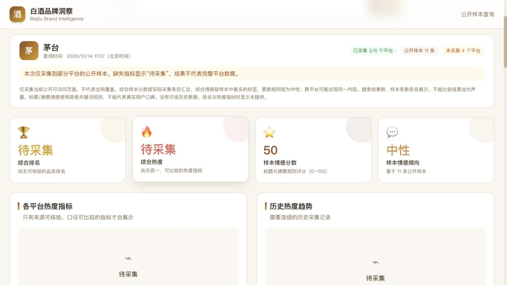

# 白酒品牌洞察

查询白酒品牌相关公开内容，查看来源采集状态、可追溯报道和样本情感分析。桌面程序内置运行环境与本地服务，安装后双击打开，无需安装 Node.js、输入命令或单独启动后端。

当前版本：**1.0.1 测试版**。

## 直接使用软件

普通用户选择安装包，不需要下载和运行源码。

| 安装包 | 目标系统 | 打开方式 |
|---|---|---|
| `Baijiu-Insight-1.0.1-mac-universal.dmg` | macOS 13 或更高；Apple Silicon 与 Intel 通用 | 双击 DMG，将 `BaijiuInsight.app` 拖入“应用程序”，再双击应用 |
| `Baijiu-Insight-1.0.1-win-x64.exe` | Windows 10 / 11，Intel 或 AMD 64 位处理器 | 双击安装器，按向导完成，打开桌面“白酒品牌洞察”快捷方式 |
| `Baijiu-Insight-1.0.1-win-arm64.exe` | Windows 11，ARM64 处理器 | 双击对应安装器，按向导完成，打开桌面快捷方式 |

安装包是独立交付文件，不放进 Git 源码仓库。发布到 GitHub 后可在 **Releases** 提供下载。

这些是未使用发布者证书的测试包。Mac 使用本地 ad-hoc 签名，未获得 Apple 公证；Windows 未使用开发者证书签名。系统可能提示发布者无法验证或阻止打开。面向公众分发前需要配置正式签名与对应验证，不能承诺所有电脑都无提示双击启动。[安装与验证说明](docs/INSTALL.md)

## 操作流程

1. 双击桌面应用。
2. 输入品牌或点击热门品牌，点击“查询”。
3. 查看本次采集到的平台、样本条数和缺失说明。
4. 展开内容摘要或点击原文链接；来源原文由系统浏览器打开。
5. 查询较慢可点击“取消查询”，失败可点击“重试”。

结果只反映当前可访问的公开内容。采集失败、访问限制或没有可靠指标时明确显示待采集，不生成随机值。暂无可信品类排名、统一热度、历史趋势或维度评分时保留空状态。

## 数据源接入

当前采用公开页面采样，尚未新增官方付费 API。六类数据源所需的账号、审核、授权、历史和额度要求已整理在 [数据源接入需求](docs/DATA_SOURCES.md)。取得数据权限和接入软件是两个独立步骤；打包不等于平台权限已经开通。

